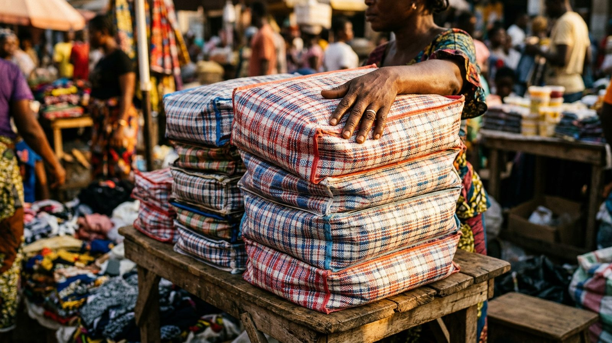
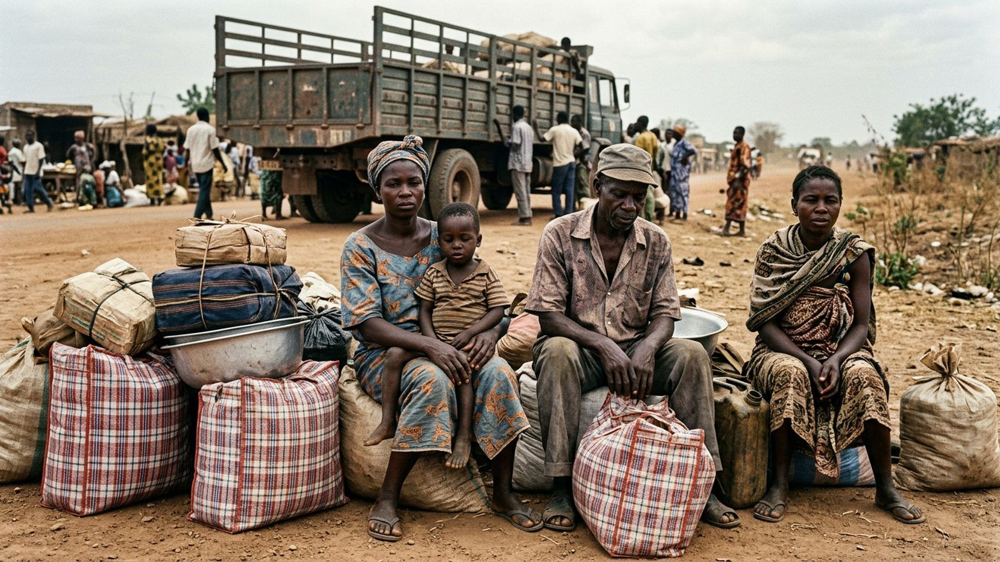
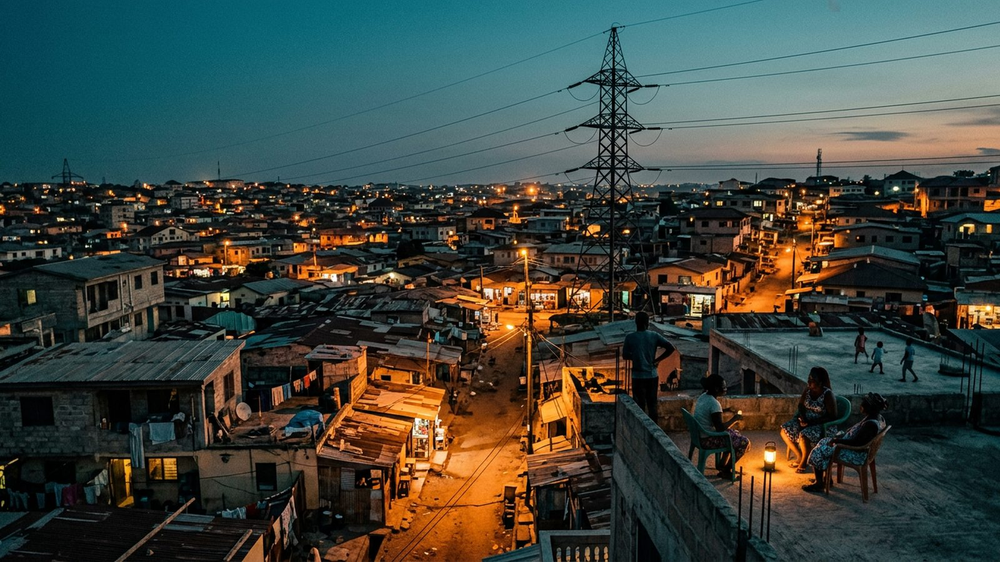

In Nima market in Accra, a woman called Agnes Ambomah sells them from a roadside stall, stacked four deep, red and white and blue, and she calls out the name the way a crier calls out tomatoes.

"Ghana Must Go is here, come and buy. It's good, it's good."

She is 38. She was born thirteen years after the events that gave the bag that name and she uses it the way you use a word you have never looked up. "This red one is very good quality," she said, lifting one for a customer. "This one is original."

Twenty minutes' walk away, in the dim clutter of Makola market, a 70-year-old clothing trader named Bashiru Tahiru keeps his stock in anything but that. He knows exactly what the name means. In 1983 he was a port labourer in Lagos, and he packed his life into one of those bags and left Nigeria on a ship sent by his own government to collect its citizens.

"It's a bad luck bag," he said. "I don't use it."

Two people in the same trade, in the same city, on the same afternoon: one selling the thing, one refusing it. Neither of them using the phrase that most of the world knows it by, because in Ghana, where most of the people carrying it were going, the bag has a different name.

## The Other Name

In Twi it is *efiewura suame*: landlord, help me carry my bag.

Read that twice, because almost everything in this story is folded into the difference between those two names. One is a verdict on a people — *Ghana must go* — issued by a government that had decided a million residents were a problem to be solved by departure. The other is a request addressed to a stranger at the side of a road. One tells you what was done to you. The other tells you what you asked for.

Both names describe the same month. Both names are West African. Neither of them is about the bag, which is why the bag has been able to survive them.

## A Bag From Somewhere Else

The first thing to get straight is that this is not an African object. The weave is polypropylene, a plastic developed in the middle of the twentieth century and extruded into flat tapes, then woven into a sheet that is strong, waterproof, unrippable and almost weightless. Japan made it first, and made it blue and plain, as a construction material — sheeting for scaffolding, covers for building sites — and that is still the main thing it does there. It travelled to Taiwan and Hong Kong and was turned into luggage. A Hong Kong tailor named Lee Wah reportedly made the first zip-top versions in the 1960s. Nobody has produced a company archive proving it; every account of the bag's origins depends on the same journalistic chain, so "reportedly" is the honest word.

What matters is the shape of the trade. By the late 1970s, a factory in East Asia could make a bag that a market trader in Kumasi or Lagos could sell for a dollar or two, that folded to the thickness of a shirt, that would not tear on the roof of a bus, and that could be filled with forty kilos of anything and still be carried by one person.

Africa did not invent the bag. Africa gave it the only thing it was missing, which was a memory.

## The Map of Names

Here is the fact that turns a curiosity into a piece of history: every country that received this bag named it after the people it was watching arrive.

In Germany it is the *Türkenkoffer*, the Turkish suitcase, for the guest workers of the 1960s and 70s. In the United States it is the Chinatown tote. In Guyana it is the Guyanese Samsonite. In South Africa, where the same bag turns up on the pavements of Durban, it carries names in isiZulu — *uMas'goduke*, and others — that are not affectionate. Elsewhere it is simply the refugee bag.

A bag does not acquire these names by accident. It acquires them when a large number of poor people appear in a place with their possessions in their hands, and the people already there reach for something cheap to call the thing that is coming through the door. The bag is a receipt. Every name on it is a record of who was unwelcome somewhere, and in what language.

Seen this way, "Ghana Must Go" stops being an African peculiarity and becomes West Africa's entry in a catalogue the whole world keeps. It is simply the entry that got famous, because it is the only one that became a brand.

## The Year Ghana Went First

The usual telling of this story is that Nigeria did something monstrous in 1983 and a bag was named after it. That is true, and it is not the whole story, because Nigeria was not the first country to say it, and the people in Lagos knew that.

In 1969, Ghana's government under Prime Minister Kofi Abrefa Busia issued what it called the Aliens Compliance Order. Every foreigner without papers was to regularise their status or leave within two weeks. It was sold as a cure for unemployment and a squeeze on traders who were said to be taking work from Ghanaians. Over half a million Nigerians were out of the country by the end of that year, according to the academic record; some Nigerian retellings put the figure far lower, at 140,000, and the gap between the two is the first sign of how badly this history was counted.

In Nigeria, that is still remembered as a deportation — as *Nigeria Must Go*. It happened fourteen years before the bags.

So when the order came in 1983, Ghanaians in Lagos did not receive it as a surprise. They received it as a reply.

## The Seventeenth of January

On 17 January 1983, Nigeria's Minister of Internal Affairs, Alhaji Ali Baba, went on television and announced that migrants without documents were to leave the country by the end of the month. President Shehu Shagari endorsed it. The justification offered was crime, moral decay and jobs — the standard trio — in a country whose oil revenue had collapsed with the price of crude, whose import licences were rationed, whose wages had been frozen, and whose government was months away from an election it would win and lose within the year.

The day after the broadcast, the governor of Lagos State added his own gloss. These people were, he said, "bad eggs… a menace". He blamed Ghanaians for property crime and for cornering the best stalls in the public markets — a grievance that tells you more about the politics of market space than about any actual crime.

Then the machinery, which was the strangest part. The deadline was extended by four weeks. The order was amended to exempt some salaried professionals, nurses among them, with no guidance issued on how anyone was supposed to prove they qualified. There was no register of who was in the country. There was no way to check.

Nigeria did not need one. It had understood something about how this work is done in practice: you do not have to find a million people if you can frighten a million people into finding the border themselves.

## A Number Nobody Knows

The Ghanaian High Commission in Lagos estimated that about one million Ghanaians went home. Nigeria's own foreign minister claimed more than two million, which scholars of the episode treat as bombast. The most careful modern assessment — in a 2023 study of the two countries' duelling expulsions in *Past & Present* — concludes that the true figure was probably lower than both claims and still well into six figures, and that it is now impossible to say.

The order was not only aimed at Ghanaians. Around 200,000 people returned to Niger, 150,000 to Chad, and nearly as many to Cameroon. All of the numbers are estimates built on estimates. A country that could not count its own population was never going to produce a reliable headcount of the people it was expelling.

What is not in dispute is the speed. Two weeks, then four, to sell a shop, abandon a house, collect children from schools, and choose what fits in a bag.

## The Border, the Road, the Ship

And then Ghana made it worse. President Jerry Rawlings had sealed the country's border with Togo, citing security after a coup attempt, so the shortest route home was closed. Convoys of returning Ghanaians backed up in Benin. Hundreds of thousands were stranded in and around Cotonou with no shelter, no food, and no sanitation, waiting for a frontier to open. It did, after international pressure, and Ghana sent ships to Lagos to collect its citizens by sea.

Bashiru Tahiru was on one of them. He does not remember the crossing as an adventure. He remembers it as the moment a bag became a thing he would not touch for forty years.

Contemporary accounts describe what the road cost: people beaten and extorted at checkpoints, families separated, deaths from exhaustion, hunger and drowning. There is no figure for the dead, and it is worth saying plainly that there is no figure because nobody counted. This is what a deportation looks like when a state performs one it has not planned: not the clean movement of a statistic, but an improvised evacuation with the state as the thing people were fleeing.

Nigeria lost something too, though you will not find it in the ledger. A large part of its skilled West African workforce — teachers, artisans, clerks, drivers, the people who kept schools and building sites running — left within a month. Ghana got them back, in the middle of its own crisis, and a generation of them later helped rebuild the country they had been sent home to. That argument is made often and is hard to prove in a spreadsheet. It is nevertheless the reason the story has a second act.

## The Law That Allowed It

The most uncomfortable fact about 1983 is that it was not obviously illegal.

West Africa had built a regional order on the promise of movement. The Lagos Treaty of 1975, which created ECOWAS, imagined a community in which people, goods and money crossed borders freely. But what it actually guaranteed was ninety days of visa-free travel, not a right to live and work wherever you liked. Nigeria's government said at the time that it had acted within its treaty obligations, and on the narrow question of documents it had a case.

Underneath that lay something older and worse: the colonial-era habit of tying political membership to indigeneity — to where your people were said to be from, codified through neo-traditional "customary" law. A man born in Lagos to Ghanaian parents, who had never seen Ghana, was not a Nigerian in this framework, however long he had lived in the country or however much he had built there. The category "alien" was not a description of his papers. It was a description of his grandfather.

Which is why the same thing could happen again, and did: another expulsion in 1985, under Muhammadu Buhari, with fewer people and less noise. Cruelty that is lawful is cruelty that can be repeated, and the law had been arranged, decades earlier, to make it available.

## What the Bag Became

The bag, meanwhile, went on with its life.

It became laundry. It became storage. It became the thing a student carries a mattress in, and the thing a family sends back to the village full of shoes. The University of Ghana historian Kweku Darko Ankrah told AFP this year that it has become, simply, a utility bag — that "the negative connotation attached to migration is no longer there" — and that it has climbed from poor status to the middle and even to the elite, which is the sort of sentence that sounds like progress until you notice what it is measuring.

The artists got there first. Abdur Rahman Muhammad, a 38-year-old Ghanaian painter, uses the check pattern as a recurring background in his portraits. "In my work," he said, "it has come to represent resilience, hope and pursuit of dreams."

Then the brands arrived. Louis Vuitton put a monogrammed version of the red-white-blue bag on a runway in 2007, under Marc Jacobs, and did it again in 2025, when a leather-and-canvas interpretation went on sale for somewhere between $595 and $3,000, with the original still retailing in West African markets for the price of a meal. The criticism that followed was predictable and correct: a symbol of deportation had been turned into a luxury object without a word about where the checks came from.

There is a smaller, stranger chapter in the bag's afterlife that nobody has made into a moral. Ethiopian Airlines and some other carriers will not check these bags unless they are boxed, because they keep destroying airport conveyor belts. The bag that carried a million people home in 1983 is now, at some airports, too much for the machinery to take.

## Abahambe

In July 2025, crowds marched in Ghana calling for Nigerians to be sent home. The placards said so directly, alongside claims about crime and kidnapping that were as thinly evidenced as anything said in Lagos in 1983. It was not the policy of the Ghanaian state, and Abuja called for calm. But it was the same sentence, in the country that had given the bag its other name, four decades after its own citizens had been made to carry it.

In South Africa in 2026, the sentence acquired a different word. From March, marches organised by movements including March and March and Operation Dudula spread from KwaZulu-Natal into Johannesburg, Pretoria, Durban and the Western Cape under the slogan *abahambe* — they must go — and set 30 June as the deadline for undocumented foreigners to leave. The violence that gathered around those marches killed at least seven foreign nationals by May, with later counts reaching eleven. Around 30 June, more than 900 people were arrested. An estimated 56,000 Malawians and 115,000 Zimbabweans left their homes; South Africa deported roughly 19,000 people in a matter of months; and Ghana, Nigeria, Mozambique, Malawi and Zimbabwe began paying to bring their own citizens home.

Ghana summoned South Africa's ambassador and wrote to the African Union. Nigeria protested formally. Two countries that had expelled each other's citizens in 1969 and 1983 were, in 2026, jointly evacuating their people from a third.

And then the detail that makes the whole story turn. In the online argument that followed, some South Africans cited Ghana Must Go as evidence that every nation has the right to say, of the people inside it, that enough is enough. A deportation that ended forty-three years ago had become a precedent — cited, approvingly, by people preparing to do it again.

The bag travelled out by road this time. At the airports, the airlines would not take it.

## The Country That Was Told to Go

Here is the part that is hard to write without sounding like a scoreboard, so it should be stated carefully and then qualified immediately.

Ghana, the country that was told to go, has spent the decades since building the things a state is supposed to build. Nigeria, the country that did the telling, has spent them building substitutes for those things, and has been widely admired for it.

Start with power, which is where the difference is easiest to see. In 2024, 91.9 per cent of Ghanaians had access to electricity. In Nigeria, 62.5 per cent did — a gap of nearly thirty percentage points, and on a much smaller population, which makes Nigeria's failure the larger one in absolute terms. Ghana's conventional generating capacity runs to roughly 5,300 megawatts for about 35.7 million people. Nigeria has installed capacity of about 13,600 megawatts on paper but delivers somewhere around 4,000 to 5,000 megawatts to more than 240 million people. Do the arithmetic and it comes out at roughly 150 watts per person in Ghana against roughly 20 watts per person in Nigeria. Ghana generates about seven times as much power per head as Nigeria does, for a country with a seventh of the people.

That is the clean version. Here is the qualification, and it matters, because Ghana is not a country that has solved electricity. Sixty per cent of northern Ghana has access, not ninety. Ghana load-sheds — *dumsor* is a Ghanaian word for a reason — and its gas supply has failed it often enough that in the World Bank's 2023 enterprise survey, 74 per cent of Ghanaian firms reported power outages. Nigeria's equivalent figure in the most recent survey is 82 per cent. Ghana has won the access race and is still losing the reliability race. It is simply further along the road than its neighbour, not at the end of it.

Income per head tells the same story from another angle. On IMF projections for 2026, Ghana's GDP per capita sits somewhere between $3,100 and $3,600; Nigeria's between $1,100 and $1,600. Ghana's economy is around a third the size of Nigeria's and its income per person is two to three times higher — which is another way of saying that Nigeria's scale is real and so is its poverty, and that the country with the bigger headline number has the smaller life per person.

Ghana also defaulted. In 2022 it did the thing everyone had said it was too well managed to do: it missed a payment, its currency fell, inflation reached the mid-fifties, and it went to the IMF. By the middle of 2026 it had completed that $3 billion programme ahead of schedule, rebuilt reserves to about $13.8 billion, and brought inflation down to 3.2 per cent in March — against roughly 15.4 per cent in Nigeria in the same period. The recovery is not proof of virtue. It is proof that a state can still operate the machinery of a state, that its institutions can sign, disburse, report and exit a programme in the order they promised.

The governance numbers are blunter. The Mo Ibrahim Foundation's 2026 index, published at the end of October, ranks Ghana ninth of fifty-four African countries on overall governance, with a score of 62.8; Nigeria is thirty-eighth on 44.2, down 5.2 points over the decade, the second-steepest decline on the continent after Burkina Faso, and the only country to deteriorate across all four dimensions the index measures. And the honest note: Ghana declined over the decade too. It is classed as bouncing back from a fall, not as ascending. Both countries are slipping. One is slipping from a much higher floor.

Money is the last measure, and the one where the difference looks most like the future. In 2025, Ghana processed GH¢4.54 trillion of mobile money across about 9.7 billion transactions, with 26.7 million active accounts on a population of roughly 34 to 36 million and about 491,000 active agents — interoperability between networks since 2018, and a jump in volumes after the electronic transaction levy was scrapped. Those are the kind of numbers that make foreign fintech reporters visit Accra. They do not prove that Ghanaians are richer. Agent-to-agent transfers were 41 per cent of the value, which tells you how much of that money is liquidity being moved around rather than commerce being done.

None of this makes Ghana a better country to be poor in, or Nigeria a worse one to be ambitious in. Nigeria has the continent's largest consumer market, its loudest culture industry, its most consequential private sector, and a diaspora whose remittances and skills are not captured by any of the figures above. Its size is not only a burden. It is also the reason it can do things Ghana cannot.

But the comparison has one thing to teach, and it is not that Ghana is admirable. It is that the two countries took the same sentence — *these people must go* — and then spent forty years proving different things. One built capacity: a grid that reaches almost everyone, a currency that recovered, a payment system the rest of the continent studies, a governance score in the top ten. The other built substitutes: twenty-two million generators, boreholes in every compound, private security on every street, private schools for anyone who can afford them, and a national habit of describing all of it as resilience. That is one reading of the last four decades, and readers are entitled to another. It is the reading the 1983 order invites.

## What the Bag Is Called Now

The bag does not remember anything. It is woven plastic. It will outlive everyone in this story by several decades, and in 2050 it will be sold in the same markets by people who have never heard of Ali Baba, Shehu Shagari or Busia, and who will call it whatever their grandmothers called it.

The people remember. That is the asymmetry at the heart of it: an insult attached to an object can be worn away by use, until a historian can say the stigma is gone and a 70-year-old can say it is a bad luck bag, and both are describing the same market on the same afternoon. What does not wear away is the sentence. In 1969 it was said in Accra. In 1983 it was said in Lagos. In 2025 it was shouted on a street in Accra again, and in 2026 it was painted on walls in Durban, and each time the same bags appeared on the road.

So the questions are not historical. If a deportation can be lawful and still be a wound that outlives everyone who ordered it, what is the point of the law? If a country can be ordered out of another country and then, four decades later, be the one whose citizens are doing better on measures of power, income and governance, what was the order actually protecting? And if every generation gets to invent a fresh phrase for *they must go*, what is the phrase being invented now, in a country you are sitting in, about people you have already met?

Agnes Ambomah will keep selling the bags while those questions go unanswered. She is not sentimental about them. "It's a very simple bag," she said, "but it carries a lot inside."
