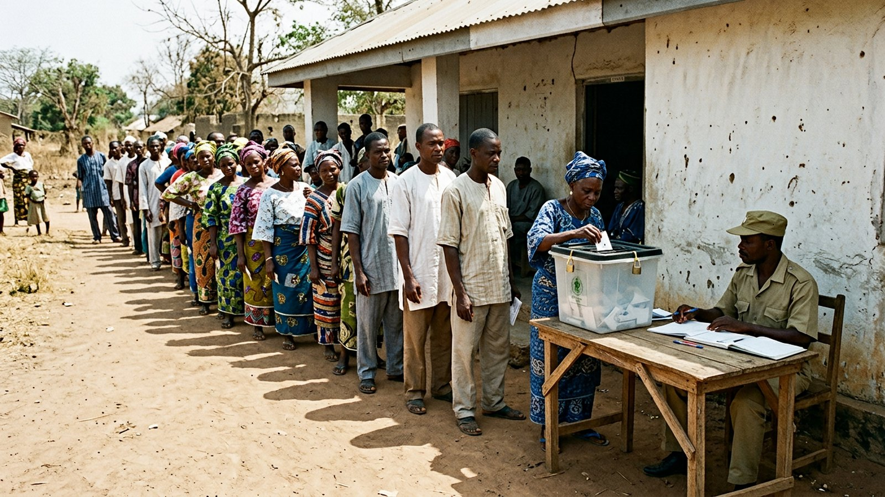
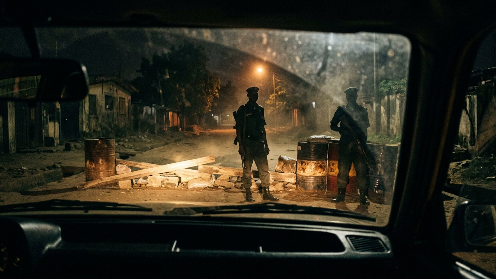
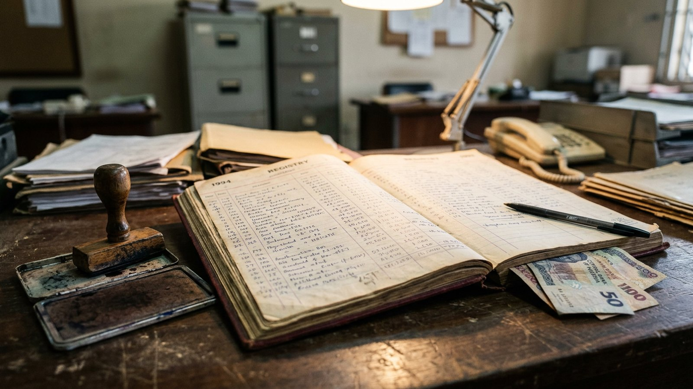
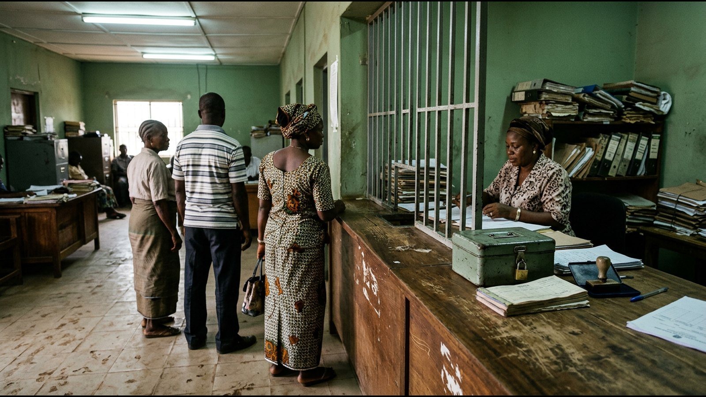

On the morning of 8 June 1998, a rumour moved faster than any radio station in Nigeria.

It came out of Abuja first — something has happened at the villa — and by midday it had reached the streets of Lagos as a name, then a chant, then a joke with the shape of a verdict. *Abacha ti lo si empire.* Abacha has gone to the empire. Commercial drivers stopped collecting fares. Beer parlours handed out drinks that had already been paid for by somebody else, and then by nobody. A song that had circulated for years in whispers was rewritten in the space of an afternoon from *Abacha rele o* — Abacha has gone home — into something far less charitable.

In Kano, where he had been born fifty-four years earlier, the reaction was quieter. Not silence; something more careful than silence. People confirmed the news to each other indoors and waited to see what would happen next.

The celebrating was real, and it was not universal, and both of those things matter to what came after. What almost nobody could have said that Monday, honestly, was what the celebrating was *for*. A death is not a policy. A funeral is not a reform. The most that could be said, and the most that was said, was that a door had opened — and that the country had been waiting so long behind it that it had stopped rehearsing what it would do on the other side.

Almost three decades later, Nigeria is still on the other side, and the question the streets were asking that morning has not gone away. It has only grown more expensive to answer.

## The Man Who Was Already in the Room

Sani Abacha was not a stranger who seized the state. He was one of the men who had been holding it.

Born in Kano in 1943, he joined the army in 1963 and moved through the officer corps during the decades when the officer corps was the real politics of Nigeria. He was in the room for the coup that removed the Second Republic in 1983, and for the one that replaced its successor two years later. Under General Ibrahim Babangida in the late 1980s and early 1990s he rose to Chief of Defence Staff — which is to say, the man responsible for the instrument that decided whether governments lived or died.

That is why the story of how he took power in November 1993 is less a story about a coup than about a country that had run out of ways to say no.

## The Election That Was Won and Never Given

On 12 June 1993, Nigerians voted in a presidential election between two candidates the military government had itself selected: Moshood Kashimawo Olawale Abiola of the Social Democratic Party, a Yoruba Muslim businessman and publisher, and Bashir Tofa of the National Republican Convention, a northern politician.

Then something happened that the men who designed the transition had not planned for. People voted as though it mattered. The queue outside a polling station in that year runs across the frame of every photograph and every memory: women in wrappers, men in loose shirts, hours of standing in the sun for a ballot that had been, in theory, arranged by the same government that would later discard it.

The collated, never-certified figures give Abiola 8,341,309 votes to Tofa's 5,952,087 — a margin of nearly two and a half million, in 19 of 30 states and the Federal Capital Territory. He won Kano, the home state of his opponent. Every account of the election agrees on the essential shape of the result; the disputes come afterwards, and they are not about arithmetic.

Announcement of the count was halted by court injunction before it could be completed. Activists leaked the collation. On 23 June, General Babangida annulled the election, citing irregularities, vote-buying and the need to protect the judiciary. No detailed public report of those irregularities was ever produced.

Read that again, because it is the hinge on which the next thirty years swing: a military government cancelled the freest vote Nigeria had held, and the reason it gave was never examined in public. The annulment did not merely steal an election. It taught two generations of Nigerians a lesson about the difference between a result and a decision.

What followed was a crisis that the military managed by moving the pieces around the board. Babangida stepped down in August 1993 and handed power to an Interim National Government under a businessman, Ernest Shonekan, which had no election behind it and no army of its own. On 17 November 1993, Abacha dissolved it and took over.

## Operation Sweep

By the time Lagosians came to use the phrase, it had already become a proper noun.

Operation Sweep was set up in 1996 under the military administrator of Lagos, Brigadier-General Mohammed Buba Marwa, as a joint police–military task force aimed at what the city called armed robbery, street crime and the extortion economy of the *area boys*. It raided, it patrolled, it stopped people, it searched them, and it was, by the reckoning of many residents, the first thing in years that had made certain streets usable after dark.

This is where the nostalgia that runs through Nigerian political conversation comes from, and it is not dishonest. Contemporary commentary in Lagos still says plainly that "the consensus was that Lagos was a much safer place under Marwa" — alongside the admission, in the same breath, that soldiers were widely accused of executing suspects without trial.

The documentary record of that second half is not vague. The United States State Department's human rights report for 1997 records that in July of that year a newspaper vendor named Godfrey Chukwu was killed when uniformed men in an Operation Sweep vehicle fired from the windows; that in February two students at Lagos State University were shot dead when the vice-chancellor called the operation in to quell cult violence; that a human-rights worker was stopped on the street, searched at gunpoint and robbed of about twenty-five dollars by Operation Sweep personnel. The 1998 report adds that in November of that year members of the operation were reportedly responsible for at least sixteen extrajudicial killings in a single month, and that in December, in Bariga, four people were killed in a clash with the Odua Peoples Congress. It adds a sentence that ought to be underlined twice: no members of the security forces were charged, tried or convicted for these killings.

Human Rights Watch would later list Operation Sweep among the police formations whose personnel it documented committing torture.

Put the two halves together and you have the shape of the thing Nigerians remember, and cannot agree about. The operation could *do* things. It could not be *asked* things. It produced order of a sort, and it produced the fear of consequences that people still describe when they say, wistfully, that in those days you could not misbehave. What it never produced was a file, an inquiry, or a single officer answering for a death.

After 1999 it was restructured and renamed the Rapid Response Squad — an institution that has spent the following decades being reformed, argued over, occasionally admired, and, after 2020, protested against under a different name altogether.

## What the Country Was Told at Five in the Morning

Abacha died in the early hours of 8 June 1998 at the Presidential Villa in Abuja. He was fifty-four. The government said he had suffered a heart attack. He was buried the same day, in Kano, under Islamic rites, without an autopsy.

That last detail is not a footnote. It is the whole argument, dressed differently.

Because there was no post-mortem, there was no finding, and because there was no finding, the vacuum filled with stories. Within weeks, American intelligence analysts were reported to have evidence that the general had been poisoned while in the company of three prostitutes — a claim the State Department would describe only as inconclusive. A senior diplomat told The Irish Times that a small group of officers had decided on poison as the only solution to a coup in the making. The same newspaper, in the same report, carried a Nigerian paper's account that blood, urine and tissue samples sent to Germany had shown no trace of it.

The apple arrived somewhere in that space. It was, in the telling, a spiked apple; then a spiked apple juice; then a woman bringing it. Nobody has produced the apple. The most senior figures closest to him disagree with each other about everything else. His personal physician, in a 2015 interview, rejected the story outright and said he had found no woman in the room when he arrived. His chief security officer has at various times blamed a handshake with a visiting dignitary's guard and, elsewhere, foreign operatives. In 2026, a retired intelligence officer published a memoir asserting that Abacha died during an encounter with a young pharmacist — an account immediately rejected by men who had been close to the regime, and supported by no document at all.

What can be said is smaller than any of these versions, and more revealing. A head of state died in the night, and the state he ran had grown so used to being the only authority that it did not think of the public as an audience that required reasons — so it buried him in daylight and said nothing that could be checked. The secrecy was not a cover story. It was the regime, showing what it was, one last time.

> A country that cannot audit its rulers will always have a story about an apple.

## Thirty Days Later

If Abacha's death seemed, for a day, to settle something, Abiola's death settled nothing at all.

Abiola had spent four years in detention, most of it in isolation, charged with treason for declaring at Epetedo in June 1994 that he was the legitimate president of Nigeria. Around him, the political crisis had eaten his family: in June 1996 his senior wife, Kudirat, was shot dead in Lagos for running the campaign he could no longer run himself.

By 7 July 1998, a new head of state, General Abdulsalami Abubakar, was preparing to release him. A United States delegation — the diplomat Thomas Pickering and the assistant secretary Susan Rice among them — met him in a government guesthouse in Abuja that day to discuss the pending transition.

He fell ill during the meeting and died. He was sixty. He had won an election five years earlier that no one had been allowed to hand him.

A five-man international team led by the Chief Coroner of Ontario, Dr James Young, performed the autopsy within days. Their preliminary finding was reported on 12 July: severe narrowing of the main coronary arteries by fatty plaques, and a significantly enlarged heart caused by long-standing hypertension — heart disease of a type and severity that could cause sudden death. "We believe that poisoning is extremely unlikely," Young said. Final toxicology in Ontario and tissue examination in London, reported in August, confirmed it.

The tea was served. The tea was not the story. The story is what Abiola's son said when the official explanation arrived, and which no autopsy could answer: "You don't have to poison a man, you don't have to spike his tea, to kill him. My father was locked up for four years without proper medical treatment, and that is what leads to death."

Violence erupted in Lagos and elsewhere; the country buried him within hours of the autopsy, and then the politicians began the business of deciding what his death would mean. In 2018, a civilian government would do what twenty years of anniversary speeches had not: Muhammadu Buhari declared June 12, not May 29, the new Democracy Day and conferred on Abiola, posthumously, the highest honour in the land.

## The Handover, and What It Was Not

Abdulsalami Abubakar took office on 9 June 1998 and, within six weeks, had begun dismantling the machine he inherited. On 20 July he announced a programme: local government elections in December, state elections in January, national assembly in February, presidential in February, handover on 29 May 1999. He released the political prisoners — Obasanjo among them — dissolved the five parties Abacha had designed for himself, annulled the elections held under that design, and set up a new electoral commission.

Four elections in under three months is a speed that looks heroic on paper and is risky everywhere else. The presidential result, a 62.8 per cent win for Olusegun Obasanjo against Olu Falae, was marred by irregularities serious enough that the loser challenged it in court and lost. The constitution the new republic would live under was promulgated by the departing military government; it was not ratified by referendum. And the man taking office as the first civilian president in fifteen years was himself a former military head of state, with the blessing of a former military ruler.

None of this was hidden, and none of it was accidental. The Fourth Republic was born in a hurry, by negotiation, on terms set by the people who were giving up power — and it settled the big question (soldiers out) while leaving the harder ones (who answers for what, and to whom) open.

Those are the questions that June 1998 was really about. And they are still open.

## Where the Money Went

In 1998, the new government set about the business of finding the money.

Estimates vary and should. Transparency International's figure of up to five billion dollars looted during Abacha's five years is the most widely quoted; it is an estimate of scale, not an audit. What is documented is the recovery. Across more than two decades, roughly 3.6 billion dollars has been traced and returned — from the family itself, from Switzerland, from Jersey, from Liechtenstein, from Luxembourg, and latterly from the United States.

The pattern of it is worth following, because it explains a great deal about how the country learned to talk about corruption. In 1998, 750 million dollars came back from the family. Then 64 million from Switzerland in 2000. Then 1.2 billion from the family in 2002. Jersey returned 160 million in 2003 and Switzerland 88 million the same year. Switzerland returned another 461 million in 2005, another 44 million in 2006. Liechtenstein paid 227 million in 2014. Luxembourg and Switzerland returned 322 million in 2018. The United States and Jersey repatriated 311 million in 2020, and a further 23 million in 2022.

The World Bank's Stolen Asset Recovery database records the Swiss criminal case that ran alongside the returns, in which an investigating magistrate found Abacha's son Abba guilty of corruption and ordered the confiscation of some 350 million dollars held across Luxembourg and the Bahamas.

Three numbers live in that paragraph and they are constantly confused with one another: what was allegedly taken (an estimate), what was recovered (a documented total), and what happened to the recovered money afterwards (a question about governance, and a much harder one). Return agreements now involve civil-society monitoring precisely because the first time round they did not. When a former first lady said in 2025 that the money had been "saved" for Nigeria, the country recognised the manoeuvre instantly: the loot becomes a fund, the fund becomes a favour, and nobody has to say out loud that it was ever theft.

## The Ledger Since 1999

So: what has the democratic era done with the thing Nigerians believed they were dancing towards?

Start with the architecture, because the building is real. Two anti-corruption agencies were created in the first administration — the Independent Corrupt Practices Commission in 2000, the Economic and Financial Crimes Commission in 2003 — along with a procurement regime, a fiscal-responsibility law, and an asset-recovery machinery that has, among other things, brought some of Abacha's own money home. None of that existed in 1998. Protest, publication and investigation are legal in a way they were never legal under the generals.

Then start with the measurement, because the measurement is less flattering.

The third national corruption survey, conducted by the National Bureau of Statistics with the UN Office on Drugs and Crime and published in 2024, found that 27 per cent of Nigerians who had contact with a public official in the previous twelve months paid a bribe — a slight fall from 29 per cent in 2019. Count refusals as well as payments and more than one in three encounters involved bribery. An estimated 87 million bribes were paid in 2023, with a total value of about ₦721 billion, more than 700 billion naira exchanged quietly, hand to hand, in a single year.

The survey's most uncomfortable finding is not about police officers or passport desks. It is about jobs. Around 60 per cent of people who secured public-sector employment between 2020 and 2023 said they had used bribery, nepotism, or both to do it. In half of the cases where the process included a written test or an interview, the proportion fell — but did not fall far.

That is not a statistic about politicians. It is a statistic about the country's preferred method of distributing opportunity.

Now set that beside the economy. The World Bank's assessment for 2025 put the share of Nigerians living below the national poverty line at 63 per cent — roughly 140 million people, up from 56 per cent in 2023. Inflation, which reached nearly 35 per cent at the end of 2024, has since come down to the mid-teens, and food inflation remains near 19 per cent. Slower price rises have not meant cheaper food. A household whose income doubled in naira terms over six years may have watched the same basket of groceries rise by more than five times.

And set beside that the thing that did not exist in 1998 at all.

Between July 2025 and June 2026, according to SBM Intelligence, 7,825 people were kidnapped in Nigeria in 1,713 incidents — a 66 per cent increase on the previous year — with at least 1,142 killed and ₦7.78 billion in confirmed ransom payments. That is roughly twenty-one abductions a day. In the twelve months before, the figure was 4,722. The mass abduction of schoolchildren, a phrase that now needs no explanation to a Nigerian reader, is not an inheritance from the military era; it is a product of the last fifteen years.

Comparing eras here is genuinely difficult and should be done carefully. Crime was not measured in 1998 the way it is measured now; there was no national kidnapping database because there was no kidnapping industry. What can be said without exaggeration is that the *kind* of fear has changed. In the 1990s a Nigerian family feared the state and, on bad nights, the armed robber at the gate. In the 2020s it fears the state less, and fears a great deal more besides.

## The Snake

Which brings us, inevitably, to the snake.

In February 2018, auditors examining the accounts of the Joint Admissions and Matriculation Board's office in Makurdi could not account for ₦36 million in proceeds from the sale of scratch cards. A sales clerk, Philomina Chieshe, was reported to have told the board's registrar that a mysterious snake had entered the vault and swallowed the money.

The story detonated, as it was always going to. A senator turned up at JAMB's headquarters with snake charmers and anti-venom. Cartoonists retired the phrase "Nigerian factor" in favour of something with scales. JAMB's spokesman called it criminality dressed as comedy: there was no snake, there was a shortfall, and the board was determined that whoever was inside the vault would not be spared.

Then it got more ordinary, and therefore more interesting. Chieshe told CNN she had never said any such thing — that she had not even been questioned about it. The EFCC's investigation produced statements, taken before the snake became public, in which she said the money had been collected from her piecemeal by her zonal coordinator, Samuel Sale Umoru, who was reported not to have denied it. In 2020, an EFCC investigator testified in the resulting case.

What the courts finally concluded is not something this article can assert: reporting on the matter describes proceedings, not a published verdict that closes the question. But the outcome was never really the point. The snake became a proverb because it described something Nigerians already understood — that money can vanish from a government office with no one answering for it, and that the explanation offered will be, if not a snake, then something with a snake's nerve.

The temptation, at this point, is to reach for the strongman's answer: in the old days, somebody would have been afraid.

Hold that thought against what Operation Sweep actually was. It was a street operation — patrols, checkpoints, raids, arrests. It had no audit mandate, no forensic accountants, no power to trace a bank transfer, and no authority over a vault in Benue. Nobody in a military government would have audited a scratch-card ledger; a military government's idea of accountability was that the money was not the public's business. Fear of a rifle has never located a missing ₦36 million.

The distinction the country keeps failing to make is the one that matters most here.

Punishment without institutions produces quiet streets and unanswered questions. Institutions without punishment produce files, reports, and the particular Nigerian exhaustion of knowing exactly what happened while nothing is done about it. A country that has both is a country that no longer has to choose between being safe and being free.

## Why People Miss the Jackboot

There is a version of this conversation that happens in every Nigerian beer parlour, and it is worth taking seriously rather than flinching from.

The argument goes: things worked. There was discipline. An official who stole would disappear. A robber caught was a robber finished. The roads were safe. The currency was strong. You could not open your mouth in public, but you did not need to lock three doors at night.

Some of that is memory editing itself — the naira was not strong in 1998 by the standards of a country that had just spent the 1980s devaluing it, and the roads of that era carried their own dangers. Some of it is true in ways the democratic era finds hard to answer: the visible speed of enforcement, the sense that consequence existed, the fact that no one had yet been told that the law was an option.

But the nostalgia leaves out the ledger.

It leaves out Decree 2 and detentions that needed no charge. It leaves out the execution of Ken Saro-Wiwa and eight Ogoni men in 1995, and the international isolation that followed. It leaves out print runs seized, offices surrounded, editors warned. It leaves out an election annulled and a president killed in detention without medicine. It leaves out a treasury siphoned into foreign vaults while soldiers explained that such matters were above the public's pay grade. And it leaves out the sentence from the State Department's 1998 report that no member of the security forces was charged, tried or convicted for the killings attributed to their operations.

Those are not the costs of order. They are the costs of a particular kind of order: one in which power has no file.

It also has to be said, because the nostalgia so often implies otherwise, that civilian rule did not end state violence. Within months of the handover, soldiers destroyed the town of Odi in Bayelsa; in 2001 they did something similar at Zaki Biam. A police unit that began as a crime-fighting squad ended, in 2020, as the subject of the largest youth protest in the country's modern history, and the panels that followed documented what the protesters had said. Democracy did not make Nigerian officials gentle. It made them answerable in principle — and then tested, repeatedly, how rarely that principle was enforced in practice.

## The Questions

So return to the morning. Return to the drivers waving passengers in for free, the free bottles, the song rewritten in an afternoon, the careful silence in Kano, the soldiers firing into the air. What exactly was being celebrated?

Not a policy. Not an institution. A door.

The country behind that door has spent nearly three decades discovering that a door is not a house. It has built real things — elections held on schedule, a press that publishes, courts that occasionally embarrass the powerful, an anti-corruption machinery that exists and sometimes works. It has also presided over the largest rise in poverty in its modern history, a kidnapping economy no military government ever had to imagine, and a corruption problem that has moved out of the villa and into the hiring committee, the hospital queue and the examination hall.

The questions that follow do not arrange themselves into a verdict, and should not be forced into one.

If Operation Sweep made Lagos safer, what was the price, and who was told they had to pay it? If the fear of punishment produced better behaviour, did it produce better people — or only people who understood that some people can never be punished? If bribery is spread through offices, schools, hospitals and recruitment panels, is changing the man in Aso Rock the mechanism that fixes it, or has the country been treating a national habit as an election problem? Have Nigerians become more accountable to one another, or only more fluent in condemning the accountability of others? And if a military government could enforce some rules more visibly, could a civilian one build institutions that enforce them without asking anyone to disappear?

Nearly thirty years after Nigerians danced in the streets at the news of a dictator's death, how much has actually changed — and what kind of country has the dancing built?

The man died in the early hours of a Monday, and was buried before the sun went down, and the country that celebrated has been arguing about it ever since. That argument is not a failure of gratitude. It is the most democratic thing Nigeria does.
