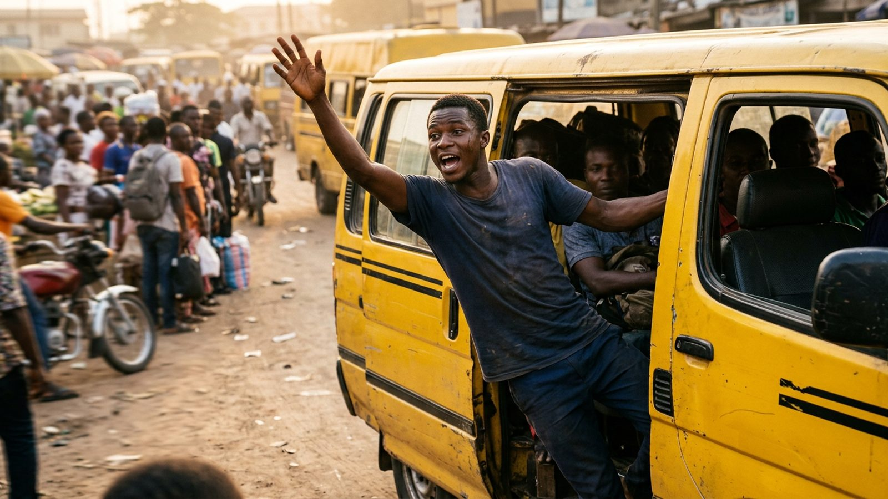
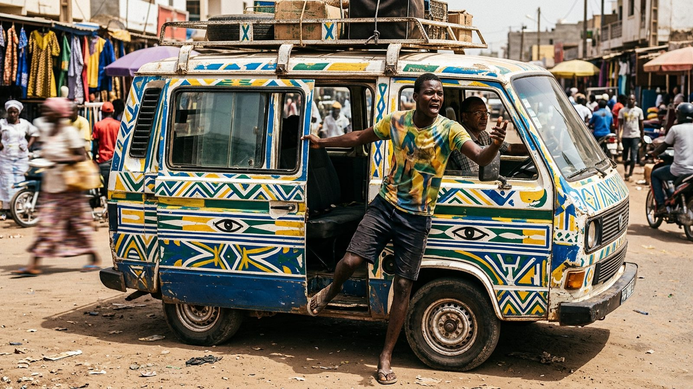
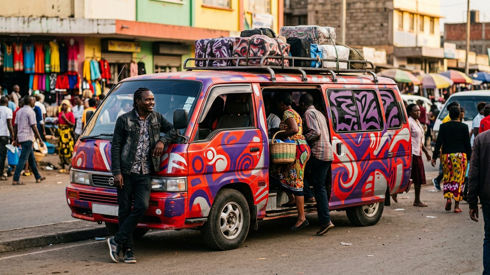

At twenty to six in the morning, the motor park is already a market. Engines idle in a fog of exhaust, conductors hang out of doorways, and a line of yellow buses with black stripes waits to be filled by hand, seat by seat, in the dark before Lagos wakes up properly.

Nobody here is waiting for a timetable, because no timetable exists. The bus leaves when it is full. Until then it is a room: a woman selling sachet water through the window, a man asleep against the glass, a student revising with a phone torch, someone arguing about a fare that went up last month and will go up again. When the fourteenth passenger sits down, the conductor slaps the roof twice and the bus moves.

That is the entire system. It has no logo, no route map on a wall, no subsidy, no schedule, no pension fund, no press office. It carries most of the people in one of the largest cities in the world, and it was built by nobody in particular, out of vehicles that were going to be thrown away anyway.

Lagos calls it the danfo.

## The System Nobody Built

The numbers are strange enough to state plainly. An estimated 75,000 danfo minibuses run in metropolitan Lagos, on 759 routes, and in 2009 — the last year for which the city's own travel survey gives a figure — they carried 62 per cent of all motorised trips. Fifteen years later, the head of the Lagos Metropolitan Area Transport Authority put their share of passenger movement at about 75 per cent. Government public transport, in the same city, was carrying 5 per cent of trips when that 62 per cent was measured.

This is not a Lagos curiosity. It is the default arrangement across the continent.

Nairobi has an estimated 20,000 matatus carrying something like seventy per cent of commuter trips, on more than 130 mapped routes. Accra has around 11,200 trotros — plus some 22,000 shared taxis — and the trotro alone carries roughly seventy per cent of daily commuters, operating out of more than 300 terminals through at least 25 unions and associations. In Cape Town, which is among the most formalised cities in Africa, minibus taxis still account for about half of all public transport trips, more than the buses and the trains combined. Dakar has 2,500 to 3,000 car rapides and ndiaga ndiayes, roughly two-thirds of its passenger fleet. In Maseru the minibus taxi is 74 per cent of motorised trips; in Kinshasa about 1,200 minibuses carry a third. Across African cities, informal transport has been measured at up to 95 per cent of motorised trips in some places.

And the detail that ought to be printed on the wall of every transport ministry on the continent: almost none of it receives a subsidy. The trains, where they exist, are subsidised. The formal buses, where they exist, are subsidised or were bought with concessional money. The minibus that carries the majority pays full price for its vehicle, its fuel, its tyres, its repairs, its union ticket, its licence, and the daily attentions of whoever controls the park — and then competes for passengers at a fare set by the street.

It is the most efficient public transport system in Africa in the only sense that matters to a passenger: it exists, it goes where people are, and it runs from before dawn until after the last shift. It is also unplanned, unsafe, uninsured, ageing, and in the way of the city that ministers would like to have instead.

## Fill and Go

The reason the minibus beat the bus is not that it was better. It is that it was cheaper to start.

A public bus system needs a depot, a workshop, a procurement process, a subsidy, a payroll and a plan. A minibus needs a vehicle, a route, and a man who knows both. When the state bus companies across the continent went into decline from the 1980s onwards — starved of subsidy, of foreign exchange for spare parts, and of political attention during the adjustment years — the minibus was already there, running the routes the buses had abandoned. It did not need permission. It needed passengers.

Lagos had its own bus tradition before this one. The *molue* — a long, high-capacity body built onto a lorry chassis, painted yellow, entered through a hole at the back — was the city's mass transit for a generation, and the state bus company ran services in Accra, Nairobi and Dakar too. What killed them was not the minibus. It was the withdrawal of the money and the maintenance that a scheduled service requires, at exactly the moment the cities doubled in size. A bus that comes every twenty minutes needs a workshop, spare parts and a payroll in foreign exchange. A bus that leaves when it is full needs none of those things, which is why the minibus did not so much defeat the state bus as inherit its passengers.

Everything about the service follows from the fare. A minibus does not move until it is full, because an empty seat is money lost; it drives fast once full, because the next load is money earned; it stops wherever a hand goes up, because refusing a passenger is refusing income. The fill-and-go rule explains the two things that infuriate everyone who does not depend on the system: the long wait at the park, and the reckless speed afterwards. They are the same behaviour.

Out of that also comes the shadow governance. In Lagos the parks are controlled by unions — the National Union of Road Transport Workers and the Road Transport Employers Association of Nigeria — and by the men who collect on their behalf, the agberos, who function as an unofficial tax authority with a bad temper. In Nairobi, the legal form is the SACCO: every matatu is supposed to belong to a registered savings and credit cooperative, which holds the route and disciplines the crew. By 2025 the regulator recognised 272 SACCOs in Nairobi while City Hall's own estimate of how many actually operate was closer to 692, which tells you how much of the industry answers to bodies nobody has vetted.

Nobody designed this. It grew the way cities grow when the state steps back: by private arrangement, enforced by whoever is standing there.

## The Ladder

The minibus is also a labour system, and it is one of the few in Africa that still has a visible ladder.

A boy starts as a conductor — the *makanga* in Nairobi, the *mate* in Accra, the apprentice in Dakar, where a car rapide carries a driver, a relief driver and two apprentices. He hangs out of the door, calls the route, collects cash, knows the fares, counts change faster than the passenger can check it, and learns every police checkpoint, every pothole, every school that lets out at three. If he is good, he becomes a driver. If he is very good, and patient, and lucky, he buys a vehicle and becomes an owner, and employs a boy to hang out of the door.

None of them has a contract. Kenyan court filings by twelve matatu SACCOs last year described their operations in the language of any small business: 1,200 vehicles, 3,485 staff, and a warning that a ban on using petrol stations as termini would cost the economy more than KES 14 billion a year. Those are jobs with no pension, no health insurance and no protection from the day the route changes — and they are the reason the industry has political weight.

Multiply it out and the scale becomes easier to see. Accra's 11,200 trotros, each with a driver and a mate, are more than twenty thousand jobs before anyone counts the mechanics, the fuel sellers, the food vendors at the terminals or the painters. Dakar's replacement programme counted four workers per car rapide. Lagos has never published a register of how many people work in the danfo trade, which is itself a statement about how the city regards them: the vehicles are counted in the tens of thousands, and the people are counted as a problem. When a city announces a reform, it is not announcing a change to a service. It is announcing a change to several hundred thousand livelihoods, most of whom vote.

## The Yellow Is a Law

It is tempting to think the danfo is yellow because Lagos decided yellow means danfo. The truth is less romantic: the yellow with black stripes is a *regulation*. Under the Lagos State Transport Sector Reform Law of 2018, commercial minibuses — the danfo and the smaller korope — are required to be painted yellow with black stripes; the larger mass-transit buses are to be painted red. When the state's traffic authority has done an enforcement drive, it has warned that unpainted commercial vehicles would be impounded until the needful was done.

So the most recognisable object in the most recognisable African city is a compliance artefact. The colour did not grow out of the culture; it was imposed on it, and then the culture absorbed the colour and made it mean something. Visitors photograph the yellow the way they photograph the red buses of London, as though someone had designed it. Someone did: a law.

This matters for what comes next. If the colour is a rule, it can be changed by a rule. And it is about to be.

## What It Costs

There is no honest version of this story that leaves out the bill.

Lagos has a road fatality rate of about 32 deaths per 100,000 inhabitants, according to a World Bank report on urban rail safety. In Kenya, 3,397 people died in road crashes in the first nine months of 2025 — a national figure that includes every kind of vehicle, and which the matatu industry's safety record contributes to. The minibuses themselves are old; the Africa Urban Mobility Observatory found that more than half of the minibus fleet in Maseru was over fifteen years old and in poor condition, and Maseru is not unusual. Aged vehicles with no emissions control, running on congested roads, are a public health problem measured in asthma wards.

Then there is crime. Lagos has a specific form of it, called *one chance*: a commercial bus with a driver, a conductor and several men who are not passengers, which picks up one more person, drives off, robs them at knifepoint or gunpoint, sometimes takes them to an ATM, and pushes them out of a moving vehicle. The phrase exists because passengers are told they have one chance, and that it is to hand everything over. The police have paraded suspects; victims have described being slapped, threatened with hot balm, emptied and dumped. It is not the whole industry, and the whole industry pays for it in reputation every time it happens.

And there is the ordinary indignity of being a woman on a full bus at rush hour, which almost no African transport plan has ever budgeted for.

These costs are real, and they are the reason reform is popular. Anyone who has stood at a park at six in the morning waiting for a bus to fill, while three buses behind it also wait, knows exactly why a minister wants to replace the whole thing with something that has a schedule.

## One City Tried to Replace It

Lagos actually did it, in stages, and we now have the receipts.

Between 2019 and 2022, the state government rolled out its Bus Reform Initiative: 820 new public buses on 64 routes, most of them with capacity for seventy passengers. Economists followed the rollout corridor by corridor, mapping the minibus routes, recording fares and departure times, and surveying drivers and commuters. What they found is the most useful piece of evidence anyone has produced about formalising African transport.

When a public bus entered a route, minibus departures fell. Drivers spent longer waiting at the parks, completed fewer trips, and earned less per trip as fares fell. Across the city, roughly 11,000 minibus drivers lost about $1.1 million a month in income — around **60 per cent of the total gains that commuters received**. And after all of it, private minibuses still carried about 52 per cent of trips.

Read that again, because it is the whole argument in one sentence: the reform made commuters better off, and six-tenths of the benefit was taken out of the pockets of the drivers. The researchers' conclusion is not that reform was wrong. It is that a hybrid system is here to stay, and that the design question is how to compensate the people whose livelihoods the public bus displaces.

Lagos is now going further. Under a Bus Industry Transition Programme, LAMATA intends to convert danfo operators into franchisees — regulated routes, regulated fares, digital payment, standards — with the unions reorganised into cooperatives to hold the franchises, and eight Quality Bus Corridors planned, four of them already under construction. Independent transport specialists have welcomed the architecture and pointed at the arithmetic: the state needs somewhere between 15,000 and 20,000 high-capacity buses to run a real network, and its own regulated fleet has been around a thousand to seventeen hundred, with roughly 170 CNG buses in the system as of October 2026. A franchise that rations a scarce fleet is not a replacement. It is a queue with paperwork.

There is a second transition running alongside the first, and it may matter more. Since the petrol subsidy was removed in 2023, the federal government has pushed compressed natural gas as the cheaper fuel for commercial transport, with a target of converting one million petrol vehicles by 2027; about 120,000 had been converted by October 2026. For a minibus operator, the fuel bill is the difference between a living and a loss, so CNG is not an ideological question. The risk is that a conversion programme designed around private and commercial vehicles quietly becomes the mechanism by which the informal fleet is retired — and the operators who cannot afford the conversion are the ones who disappear.

## Three Other Cities, Three Answers

Accra bought the buses and forgot the lanes. Its BRT, Aayalolo — a Ga phrase meaning "still moving on" — procured 245 buses in 2016. By January 2026 only about 80 of them were operational, rising to 135 after a refurbishment intervention, and the scheduled-service model had "largely collapsed". The dedicated lanes that make a bus rapid transit system rapid were never built, so the buses sat in the same traffic as the trotros they were meant to bypass, and then began stopping indiscriminately along the corridor to compete for passengers. Aayalolo has become the standard African example of a good idea defeated by a missing lane.

Nairobi went the other way: it tried to regulate the matatu rather than replace it, and kept running into the fact that the industry is not one thing. The regulator ordered the removal of graffiti and tinted windows from all public service vehicles by 11 June 2025, and banned 64 SACCOs; the matatu sector pushed back, as it has against every cashless mandate since 2014, on the ground that the rules ignore how the business actually works. Cashless payment, meanwhile, arrived anyway — not by mandate but conductor by conductor, because a displayed mobile money number beat carrying a float of coins through Nairobi traffic. That is the pattern of the last decade: the state regulates the visible surface, and the industry quietly solves the actual problem underneath.

Dakar shows what a serious replacement looks like, and what it costs. The car rapide — in service since the 1970s, painted by artisans, part of the visual identity of Senegal — has been the target of a state replacement programme since 2003, supported by the World Bank, which replaced 1,607 car rapides and ndiaga ndiayes with newer minibuses. Then came SunuBRT, West Africa's first bus rapid transit line, opened in 2024: 18.3 kilometres, 23 stations, electric articulated buses, six-minute headways, about 60 buses carrying up to 80,000 passengers a day, with a target of 150 buses and 300,000 passengers. It is the most ambitious thing of its kind in the region, and it is working. The labour assessment estimated that replacing the remaining 1,397 car rapides and ndiaga ndiayes could put something like **5,000 jobs** at risk — four workers per vehicle, in a city where those jobs are inherited.

Kigali is the exception that proves the rule: it removed minibus paratransit from the city core and replaced it with formal buses, and it worked, because the political settlement allowed the city to do what no elected government in Lagos, Nairobi or Accra can do quickly — take a route away and keep it away.

## What Formalisation Deletes

Here is the part that no cost-benefit analysis captures.

Nairobi's matatus are the most famous example: painted, decaled, lit, fitted with sound systems loud enough to be heard two streets away, and occasionally built into *nganya* — vehicles that cost more than a house and are named like racehorses. The art has been exhibited in galleries abroad, filmed, studied, and used as a shorthand for Kenyan urban identity.

In June 2025 the regulator ordered the graffiti off. The rationale was safety and accountability: a vehicle whose SACCO and route identification is obscured cannot be held responsible. The rationale is not stupid. The consequence is that a visual culture built over thirty years can be legislated out of existence in a single compliance notice.

Dakar's car rapides are painted with devotional and personal imagery; the buses are canvases, and the painters are part of the trade. In Lagos, the danfo's yellow is a law, but the slogans, the names, the hand-lettered destinations and the particular poetry of a conductor's route call are not — they are what people did with the space the law left them.

None of this is an argument for keeping unsafe vehicles on the road. It is an argument for noticing what is being traded. The minibus is ugly, dangerous and unregulated; it is also the last piece of African urban life that was made by the people who use it, rather than for them. Every reform that replaces it will produce a cleaner city and a quieter one, and something will have gone that the next generation will have to go looking for in photographs.

## Who Pays for the Improvement

The Lagos study is, in the end, a design manual disguised as an evaluation. It says that when you put a public bus on a route, three things happen: passengers gain, drivers lose, and the loss is most of the gain. Any reform that ignores the third fact will be fought by the people it is meant to serve, and it will deserve to be.

Which suggests a different order of operations. Subsidise the operator, not only the vehicle: if the public interest is in more people moving for less money, then the person whose income is destroyed by a cheaper bus is a cost of the policy, not an obstacle to it, and should be paid. Use the data that already exists rather than inventing a plan from a ministry: the World Bank's own work mapping 759 danfo routes and Nairobi's 130-odd matatu routes shows that the network is knowable, and that most of the planning has already been done by people who never wrote it down. Keep the small vehicle for the last mile, where a 70-seat bus is an absurdity, and let the big bus do the trunk. And treat the union as a contractor rather than an enemy, because the union is already the only institution that can enforce anything on 75,000 vehicles.

None of that is romantic about the danfo. It is simply the arithmetic of a system that moves three-quarters of a city's passengers for none of its subsidy, and that will keep doing so for as long as the alternative is a bus that does not arrive.

## Five Forty, Again

Back at the park, the light is coming up and the queue has changed. The night-shift workers are going home, the schoolchildren are arriving, and the conductor has begun calling a different destination, because the demand has moved. Nobody told him to. Nothing in the city's transport master plan says that this route should now become that route at 5:40 in the morning. He knows because he has been standing there since four, and because knowing is the job.

The plan, when it comes, will be drawn by people who have never done that. It will have a map, a headway, a colour scheme and a fare table. It may well be better: faster, safer, cleaner, insured, with a driver who has a contract and a bus with a working door. It will also have to be paid for, and the people who have been paying for the current system — in cash, in waiting, in risk, in the price of a vehicle that is falling apart — have never once been asked what they would like it to look like.

So the questions are not really about buses. If a service is essential enough to move three-quarters of a city's commuters, why has it never received a subsidy while the systems that carry a fraction of them have? If a reform makes commuters better off and takes sixty per cent of the benefit back out of the drivers' pockets, who is supposed to absorb that loss, and why is it always the same people? And if the matatu's art, the car rapide's paint and the danfo's yellow are the only parts of these cities that were made by the people who live in them, what exactly is being modernised when they are painted over?

The bus at the front of the queue fills, slaps its roof twice, and pulls out into the traffic with fourteen passengers and a conductor hanging out of the door. It is not waiting for permission. It never has.
